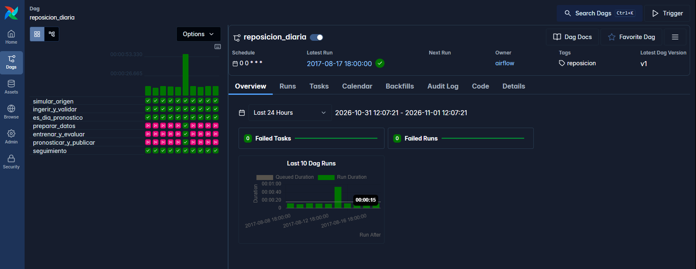
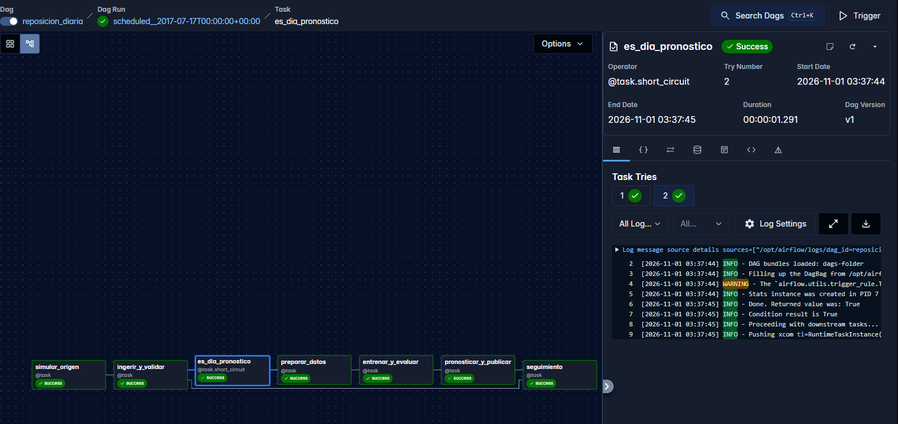
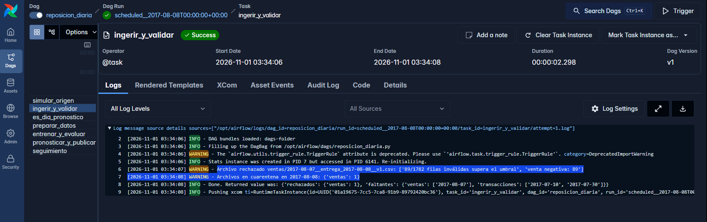

# Motor de Reposición de Inventario

Producto de ML que, cada lunes, pronostica las ventas diarias de los próximos 7 días por tienda y familia (con cuantiles p10/p50/p90), sugiere un pedido semanal a partir de los costos de quiebre y merma, y da seguimiento a qué tan acertados fueron los pronósticos anteriores. Datos: Corporación Favorita (Kaggle). Orquestación: Airflow 3. Versionado de datos: DVC.

Decisiones técnicas y de producto: [DECISIONES.md](DECISIONES.md).

## Requisitos

- Docker Desktop (o Docker Engine + Compose v2) con al menos 6 GB de RAM.
- Git.

## Ejecutar desde cero

```bash
git clone https://github.com/Rfarfan-03/Lab1-ProductDevelopment.git
cd Lab1-ProductDevelopment
```

1. Copiar los archivos de Kaggle ([store-sales-time-series-forecasting](https://www.kaggle.com/competitions/store-sales-time-series-forecasting/data)) a **`data/kaggle/`**:

   ```
   data/kaggle/train.csv
   data/kaggle/stores.csv
   data/kaggle/oil.csv
   data/kaggle/holidays_events.csv
   data/kaggle/transactions.csv
   ```

2. Solo en Linux: `echo "AIRFLOW_UID=$(id -u)" > .env`

3. Levantar Airflow:

   ```bash
   docker compose up -d --build
   ```

4. Abrir http://localhost:8080 (usuario `airflow`, contraseña `airflow`).

El DAG `reposicion_diaria` arranca solo y procesa todo el periodo con catchup, sin ningún paso manual (~10 min). Al terminar, todas las corridas deben estar en verde.

> Verificado con un clon limpio de este repositorio siguiendo exactamente estos pasos: 48 corridas sin fallas, y pedidos publicados idénticos byte a byte a los de la corrida original.

Para apagar: `docker compose down -v`. Para volver a correr desde cero, borrar también todo `data/` excepto `data/kaggle/`.

## Periodo que se procesa

Se deriva de `train.csv`: la carga histórica termina 45 días antes de la última fecha, y todo lo posterior llega como archivos diarios a la bandeja (`data/bandeja/`). El DAG corre desde el día siguiente al fin del histórico hasta 3 días después de la última venta. Se ajusta en `config/config.yaml` (`simulacion.fecha_fin_historico`, `simulacion.dias_bandeja`).

Formato de la bandeja (también acepta archivos externos con este formato):

```
data/bandeja/<fuente>/<fecha_dato>__entrega_<fecha_entrega>__v<version>.csv
fuente: ventas | promociones | transacciones | petroleo | feriados   (columnas iguales a Kaggle)
```

## Salidas

| Ruta | Contenido |
|---|---|
| `data/publicados/corte=<fecha>/` | `pronostico.parquet` (p10/p50/p90 diarios) y `pedido.csv` / `pedido.parquet` (pedido semanal) |
| `data/modelos/corte=<fecha>/` | Modelo vigente, residuos y métricas del backtest |
| `data/cuarentena/` | Archivos rechazados por la validación, con un JSON del motivo |
| `reportes/comparacion_modelos.md` | Baseline vs. LightGBM en cada entrenamiento semanal |
| `reportes/seguimiento.md` | Pronósticos publicados vs. ventas reales |

Los costos de quiebre y merma por familia están en `config/config.yaml` (`costos`). Si se cambian, el pedido cambia sin tocar el código.

## Backfill y reprocesamiento

```bash
# Re-ejecutar un rango ya procesado (todas las tareas son idempotentes)
docker compose exec airflow-scheduler airflow backfill create --dag-id reposicion_diaria \
  --from-date 2017-07-10 --to-date 2017-07-16 --reprocess-behavior completed
```

Las correcciones de datos (`__v2` en la bandeja) se incorporan solas en la ingesta del día en que llegan.

## Pruebas

```bash
pip install -r requirements-dev.txt
pytest
```

También corren en GitHub Actions en cada Pull Request.

## Versionado con DVC

El remoto es una carpeta local (`../dvc-remote-lab1`). Después de operar un periodo:

```bash
bash scripts/versionar_datos.sh          # dvc add + dvc push de data/*
git add data/*.dvc && git commit -m "data: versión de datos"
```

### Evidencia: reproducción de un pronóstico pasado

Se reprodujo el pronóstico del corte **2017-07-24** desde el commit `95b38fc` (código + `data/*.dvc` de la corrida de Airflow). El script restaura los datos con DVC, borra las features, el modelo y lo publicado de ese corte, los regenera en el contenedor de Airflow y compara contra la versión en DVC.

```bash
git checkout 95b38fc
bash scripts/reproducir_pronostico.sh 2017-07-24
```

Salida resumida:

```
== 1. Restaurar datos versionados (git 95b38fc)
== 2. Borrar artefactos del corte 2017-07-24
data\features.dvc:    changed outs:  modified: data\features
data\modelos.dvc:     changed outs:  modified: data\modelos
data\publicados.dvc:  changed outs:  modified: data\publicados
== 3. Regenerar en el contenedor
INFO reposicion.entrenamiento: Decisión de modelo en 2017-07-24: {'vigente_anterior': 'lightgbm',
     'retador': 'baseline', 'mejora_costo': -0.1406, 'reemplaza': False, 'vigente': 'lightgbm'}
INFO reposicion.pronostico: Publicado corte 2017-07-24 con modelo lightgbm
== 4. Comparar contra la versión en DVC
Data and pipelines are up to date.
d68ed3f2c05b4ab10962f6b2565131a0 *data/publicados/corte=2017-07-24/pedido.parquet
181b3ed536951da7c0db59bfcf2d0c71 *data/publicados/corte=2017-07-24/pronostico.parquet
```

`dvc status` sin cambios: el pronóstico y el pedido regenerados son idénticos byte a byte a los publicados originalmente (mismos MD5).

## Evidencia de funcionamiento

**Airflow:** 48 corridas diarias sin fallas. Los días que no son lunes, los pasos de pronóstico se omiten (rosado = *skipped*).



**Corrida de un lunes** (2017-07-17), con todas las tareas:



**Dato inválido detenido:** el archivo de ventas del 2017-08-07 traía 89 ventas negativas; se envió a cuarentena sin que el flujo fallara.



**Comparación de modelos** ([reporte completo](reportes/comparacion_modelos.md)). En el primer corte, LightGBM reemplazó al baseline (costo de negocio −27%) y se mantuvo como vigente en todos los cortes:

| corte | modelo | WAPE | cobertura p10–p90 | costo / unidad vendida |
|---|---|---|---|---|
| 2017-07-03 | baseline | 0.151 | 0.823 | 0.058 |
| 2017-07-03 | **lightgbm** | **0.127** | 0.821 | **0.042** |
| 2017-08-14 | baseline | 0.139 | 0.803 | 0.060 |
| 2017-08-14 | **lightgbm** | **0.117** | 0.782 | **0.054** |

**Seguimiento del desempeño** ([reporte completo](reportes/seguimiento.md)). Pronósticos publicados vs. ventas reales: WAPE entre 0.10 y 0.17, cobertura p10–p90 entre 74% y 84%, y un nivel de servicio del pedido entre 96% y 99%.

## Estructura

```
config/config.yaml     parámetros, costos y criterio de reemplazo de modelo
dags/                  DAG de Airflow (solo orquesta)
src/reposicion/        lógica: simulador, ingesta, validación, features, modelos, pedido, seguimiento
tests/                 pruebas (pytest)
scripts/               versionado y reproducción con DVC
data/*.dvc             punteros DVC a los datos
reportes/              reportes generados
```
